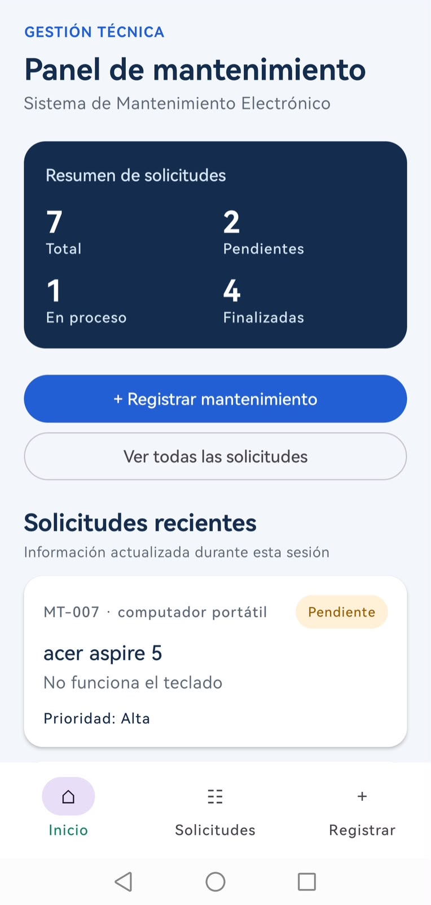
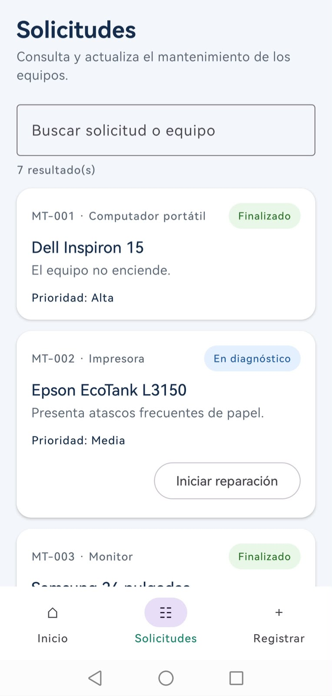
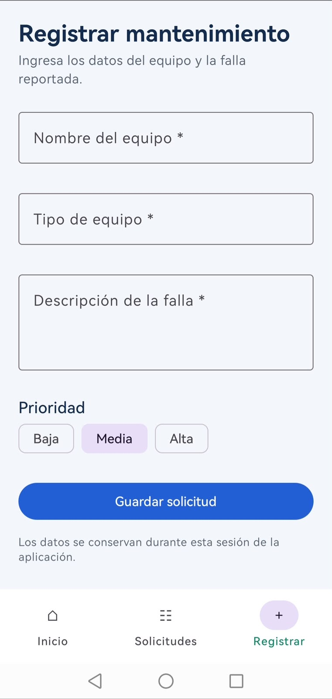

# Sistema de Mantenimiento Electrónico

## Descripción

Aplicación Android desarrollada para la asignatura Aplicativos Móviles. Su propósito es facilitar la visualización, el registro y el seguimiento de solicitudes de mantenimiento de equipos electrónicos.

El sistema permite consultar información sobre computadores, impresoras, monitores y otros dispositivos, utilizando una interfaz desarrollada con Kotlin y Jetpack Compose.

## Tecnologías utilizadas

- Kotlin.
- Jetpack Compose.
- Material 3.
- Navigation Compose.
- Android Studio.
- Gradle.

## Pantallas implementadas

### 1. Inicio

Panel principal con un resumen de las solicitudes registradas, indicadores por estado y acceso a las demás secciones.

### 2. Solicitudes

Presenta un listado dinámico de equipos mediante tarjetas reutilizables. Permite buscar solicitudes y actualizar el estado del mantenimiento.

### 3. Registrar mantenimiento

Formulario para registrar nuevas solicitudes, incluyendo el nombre del equipo, tipo, descripción de la falla y prioridad.

## Funcionalidades interactivas

**Funcionalidad 1 — Búsqueda de solicitudes (basada en clase)**

Permite buscar y filtrar solicitudes en tiempo real utilizando el texto ingresado por el usuario.

**Funcionalidad 2 — Registro de solicitudes (nueva)**

Permite crear solicitudes de mantenimiento mediante un formulario que valida los campos obligatorios. Al guardar, la información se incorpora al listado y se actualizan los indicadores.

**Funcionalidad 3 — Actualización del estado (nueva)**

Permite modificar el estado de una solicitud y visualizar el cambio tanto en la tarjeta correspondiente como en el resumen general.

## Implementación técnica

La aplicación utiliza Navigation Compose para navegar entre tres pantallas mediante NavController y NavHost.

La información se organiza mediante una clase de datos y una colección inicial de seis solicitudes simuladas. Los elementos se presentan mediante componentes Composable reutilizables.

El manejo de estado de Jetpack Compose permite actualizar la interfaz en respuesta a las acciones del usuario.

Los datos se conservan durante la sesión de ejecución de la aplicación. Esta versión no utiliza bases de datos ni servicios externos.

## Evidencias de funcionamiento

### Pantalla de inicio

### Pantalla de solicitudes

### Registro de mantenimiento

## Instrucciones de ejecución

1. Clonar o descargar el repositorio.
2. Abrir el proyecto en Android Studio.
3. Sincronizar las dependencias con Gradle.
4. Conectar un dispositivo Android con depuración USB habilitada o iniciar un emulador compatible.
5. Seleccionar la configuración `app`.
6. Ejecutar la aplicación mediante Run.

## Alcance académico

Este proyecto corresponde a una primera versión funcional del Sistema para Mantenimiento de Equipos Electrónicos.

La información utilizada es simulada y su finalidad es demostrar el uso de interfaces, componentes reutilizables, navegación, estado y eventos de Jetpack Compose.
